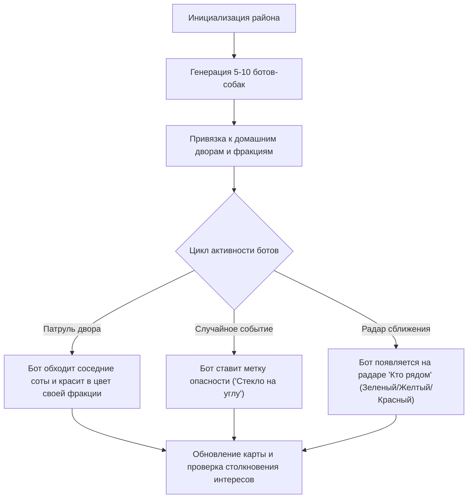

# 🏗️ Универсальная архитектура и системный дизайн (Web + Mobile + Dev Sandbox)

---

## 1. Концепция единого стека (Cross-Platform Reality)

Для обеспечения **100% покрытия всех платформ** (браузер на ПК, браузер на смартфоне, нативные Android APK, iOS и десктоп) с мгновенным локальным запуском и тестированием выбрана гибридная архитектура на базе **Modern Web + Capacitor**:

```
                       ┌────────────────────────────────────────┐
                       │     ЕДИНАЯ КОДОВАЯ БАЗА (TypeScript)   │
                       │   React 19 + Vite + Tailwind + Leaflet │
                       │           Uber H3-js Engine            │
                       └───────────────────┬────────────────────┘
                                           │
         ┌─────────────────────────────────┼────────────────────────────────┐
         ▼                                 ▼                                ▼
┌──────────────────┐             ┌──────────────────┐             ┌──────────────────┐
│  ВЕБ НА ПК &     │             │  ANDROID APK     │             │    iOS &         │
│  МОБИЛЬНЫЙ ВЕБ   │             │  (Capacitor 6)   │             │    DESKTOP       │
│ • Dev-сервер     │             │ • Фоновый GPS    │             │ • Safari PWA     │
│ • Тесты в Chrome │             │ • Вибро Haptics  │             │ • Tauri/Electron │
│ • Доступ по Wi-Fi│             │ • APK для тестов │             │   (по запросу)   │
└──────────────────┘             └──────────────────┘             └──────────────────┘
```

### Почему этот стек превосходит альтернативы:
1. **Мгновенный запуск локально:** Команда `npm run dev -- --host` поднимает сервер за 150 миллисекунд.
   * На ПК открывается: `http://localhost:5173`.
   * На телефоне по локальному Wi-Fi открывается: `http://192.168.x.x:5173`.
   * Никаких долгих сборок — любые правки в коде отображаются на телефоне за долю секунды через Hot Module Replacement (HMR).
2. **Прямая сборка Android APK:**
   * Проект инициализируется Capacitor: `npx cap add android`.
   * Сборка отладочного APK: `npx cap build android` или `gradlew assembleDebug`.
   * Готовый `.apk` скидывается на телефон для проверки работы настоящего системного GPS и фонового сервиса.
3. **Картография промышленного стандарта:**
   * **Leaflet + React-Leaflet** или **MapLibre GL JS** обеспечивают плавный 60 FPS рендеринг гексагонов Uber H3.
   * Официальная библиотека **`h3-js`** от Uber работает нативно в браузере без FFI-сложностей.

---

## 2. Архитектура подсистемы симуляции и песочницы (Sandbox & Dev Tools)

Для комфортного тестирования без необходимости выходить на улицу разработана двухуровневая система симуляции:

```
                           ┌────────────────────────┐
                           │   КОНТРОЛЛЕР ГЕОЛОКАЦИИ│
                           │  (GeolocationProvider) │
                           └───────────┬────────────┘
                                       │
                    ┌──────────────────┴──────────────────┐
                    ▼                                     ▼
        ┌───────────────────────┐             ┌───────────────────────┐
        │   РЕАЛЬНЫЙ РЕЖИМ      │             │   РЕЖИМ СИМУЛЯЦИИ     │
        │ • HTML5 Geolocation   │             │ • Виртуальный джойстик│
        │ • Capacitor GPS       │             │ • Клик по карте       │
        │ • Фоновый трекинг     │             │ • Клавиши WASD на ПК  │
        └───────────────────────┘             │ • Авто-обход квартала │
                                              └───────────────────────┘
```

### 2.1. Инструменты ручного перемещения игрока:
* **Экранный джойстик (Virtual Touch Joystick):** для тестирования пальцем в браузере телефона.
* **Клавиатура WASD / Стрелки:** для быстрого перемещения по району на ПК.
* **Клик по карте («Идти сюда»):** игрок плавно двигается к указанной точке с реалистичной скоростью шага ($4.5\text{ км/ч}$).
* **Маршрутный авто-симулятор («Замкнуть квартал»):** скрипт автоматически строит кольцевой трек вокруг текущей соты (периметр ~400–600 м) и проходит его за 30 секунд ускоренного времени для проверки захвата внутренних ячеек (Loop Enclosure).

---

## 3. Движок симуляции ботов и соседей (NPC Neighborhood Simulator)

Чтобы мир не казался пустым при локальном тестировании, в проект заложена система виртуальных собачников:



### Логика поведения ботов:
1. **Профили ботов:**
   * «Корги Билли» — Лига Спринтеров (Синяя лапа), зеленый поводок (игривый).
   * «Ротвейлер Барон» — Орден Стражей (Красная лапа), красный поводок (дергает, держите дистанцию).
   * «Хаски Скай» — Братство Вольных (Золотая лапа), желтый поводок.
2. **Поведение на карте:**
   * Боты имеют домашний гексагон и каждые несколько минут могут выходить на виртуальный выгул по алгоритму случайного блуждания (`kRing(1)` или `kRing(2)` в H3).
   * Захватывают нейтральные соты и могут ослаблять соты игрока, если тот их не навещал.
   * Отображаются на живом радаре при приближении к игроку ближе $150\text{ метров}$.
3. **Панель управления симулятором (Dev Drawer):**
   * Переключатель `[ GPS: Реальный / Симуляция ]`.
   * Скорость перемещения: `[ 1x (Шаг 4 км/ч) | 5x (Быстро) | 20x (Тест контура) ]`.
   * Кнопка `[ 🤖 Запустить выгул ботов ]` — все боты выходят на карту.
   * Кнопка `[ 🧪 Создать угрозу рядом ]` — спавнит метку опасности в 50 метрах для проверки вибро-оповещения.
   * Кнопка `[ ⏳ Симулировать +24 часа (Decay) ]` — запускает затухание очков всех сот на 33%.

---

## 4. Клиентский стек и структура модулей

```
/следы лап/client/
├── index.html                 # Главная точка входа
├── src/
│   ├── components/
│   │   ├── Map/               # Карта Leaflet + H3 Polygon Layer
│   │   ├── DevTools/          # Виртуальный джойстик, панель симуляции ботов
│   │   ├── Radar/             # Радар собак поблизости (цветовые коды поводков)
│   │   ├── Safety/            # Метки опасности, модалка SOS, подтверждения
│   │   └── HUD/               # Карманный режим, счетчик косточек, дистанция
│   ├── services/
│   │   ├── h3Engine.ts        # Обертка над uber h3-js (Res 10, kRing, polygonToCells)
│   │   ├── geoService.ts      # Абстракция GPS (Реальный GPS vs Джойстик/Симулятор)
│   │   ├── botSimulator.ts    # Движок автономных ботов-соседей
│   │   ├── territoryEngine.ts # Логика SP, захвата, замыкания контура и decay
│   │   └── storage.ts         # Локальное сохранение состояния в IndexedDB/LocalStorage
│   ├── App.tsx
│   └── main.tsx
├── capacitor.config.ts        # Конфигурация для сборки Android APK
└── package.json
```

---

## 5. Бэкенд и протокол связи (FastAPI + WebSocket)

* **Режим автономного тестирования (Standalone Mock Mode):**
  * Вся логика может работать **100% прямо в браузере без запущенного бэкенда** через локальный движок `botSimulator.ts` и `IndexedDB`. Это позволяет мгновенно открыть проект в браузере без предварительной настройки БД.
* **Сетевой режим (Full Backend):**
  * **FastAPI** с WebSocket эндпоинтом `/ws/neighborhood`.
  * Клиент передает свои координаты `(lat, lon)`.
  * Бэкенд синхронизирует состояние гексагонов и передает координаты других реальных игроков и ботов.
  * **PostgreSQL + PostGIS** сохраняет постоянную историю выгулов и метки безопасности.
