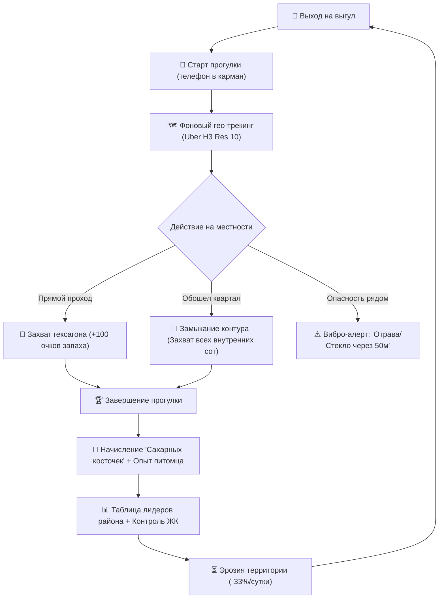

# 🎮 Game Design Document (GDD): След Лапы

---

## 1. Концепция и Кор-луп (Core Loop)



---

## 2. Гексагональная сетка Uber H3

### Выбор разрешения (Resolution):
* Для городской игры собачников используется **Uber H3 Resolution 10**.
  * **Средняя длина грани гексагона:** ~65.9 м.
  * **Диаметр (по вершинам):** ~131 м.
  * **Площадь:** ~15 000 м² (1.5 га).
* **Почему Res 10:** 
  * Это точный размер типичного двора между 2–4 домами, собачьей площадки, перекрестка или школьного стадиона.
  * Res 9 (~174 м грань, 100 000 м²) слишком велик: для захвата одной соты пришлось бы идти 15 минут.
  * Res 11 (~25 м грань) слишком мелок: перегружает БД и экран, создавая визуальный шум.

### Динамическая агрегация при масштабировании карты:
* **Зум 15–18 (Уличный вид):** отображаются гексагоны **Res 10**.
* **Зум 12–14 (Вид района):** клиентом агрегируются родительские гексагоны **Res 9** (`h3.toParent(10, 9)`), цвет определяется доминирующей фракцией.
* **Зум < 12 (Вид города):** агрегируются до **Res 8** для плавной работы интерфейса без лагов.

---

## 3. Механика захвата территорий

### 3.1. «Очки запаха» (Scent Points, SP)
Каждый гексагон имеет шкалу влияния от 0 до 300 SP.
* **0 SP:** Нейтральная территория (серая полупрозрачная сота).
* **100 SP:** Базовый захват (сота окрашивается в цвет фракции).
* **300 SP:** Максимальное укрепление («Укрепленный форпост»).

### 3.2. Условия взятия гексагона:
1. **Проход через соту:** Игрок должен пройти не менее 40 метров внутри границ гексагона со скоростью пешехода (от 2 до 8 км/ч).
2. **Захват нейтральной соты:** Начисляется 100 SP сразу по завершении условия.
3. **Атака вражеской соты:** 
   * Проход через вражескую соту сначала «смывает» очки врага со скоростью 100 SP за проход.
   * Если SP врага падают до 0, сота переходит к нападающему с 50 SP.
4. **Совместный выгул (Pack Bonus):**
   * Если 2 и более игрока одной фракции идут вместе (на расстоянии < 30 м друг от друга), начисляется множитель **x1.5 SP** за каждого компаньона.

---

## 4. Киллер-механика: «Замыкание контура» (Loop Enclosure)

Главная игровая мотивация не ходить по прямой линии «туда-обратно», а исследовать улицы вокруг.

```
       [Hex A] ─── [Hex B] ─── [Hex C]
          │                       │
       [Hex D]    [★ ВНУТРЕННИЙ ★]  [Hex E]  <-- Захватывается БЕСПЛАТНО!
          │                       │
       [Hex F] ─── [Hex G] ─── [Hex H]
```

### Правила замыкания контура:
1. Если трек прогулки образует замкнутый многоугольник (точка старта и точка финиша находятся в пределах 50 м друг от друга).
2. Все H3-ячейки, полностью оказавшиеся внутри полигона (до 19 ячеек за один выгул):
   * Автоматически перекрашиваются во фракцию игрока.
   * Получают статус **«Закрытый двор» (+100 SP к защите)**.
   * Игрок получает мгновенный бонус: **+50 Сахарных косточек за каждую замкнутую ячейку**.

---

## 5. Механика затухания влияния (Decay)

Чтобы предотвратить «вечный захват» карты топовыми игроками и дать шанс новичкам:
* **Ежесуточная эрозия:** Каждые 24 часа в 04:00 утра гексагон теряет **33.3% от текущего запаса SP**.
* Без повторного выгула за **72 часа** гексагон снова становится нейтральным (0 SP).
* Дождь/Снегопад (по данным погодного API): опциональный модификатор погодных событий «Ливень смывает следы» (ускоренная эрозия на 15%, но повышенный дроп косточек за прогулку в непогоду — «Награда храбрым лапам»).

---

## 6. Фракционная и клановая система

### 6.1. Три глобальные Фракции (выбираются при создании собаки):
1. **«Лига Спринтеров» (Символ: Синяя лапа)**
   * *Породы:* Корги, Джек-расселы, Шпицы, Бигли, Таксы.
   * *Пассивная способность:* «Ловкие лапки» — требуется на 15% меньшая дистанция для взятия соты.
2. **«Орден Стражей» (Символ: Красная лапа)**
   * *Породы:* Овчарки, Стаффорды, Доберманы, Ротвейлеры, Кане-корсо.
   * *Пассивная способность:* «Крепкий рубеж» — врагам требуется на 25% больше времени, чтобы сбить SP с их гексагонов.
3. **«Братство Вольных» (Символ: Золотая лапа)**
   * *Породы:* Метисы, Дворняги, Хаски, Самоеды, Лабрадоры.
   * *Пассивная способность:* «Следопыты» — получают на 20% больше Сахарных косточек и увеличенный радиус обнаружения меток безопасности.

*(Примечание: выбор фракции не заблокирован породой жестко — владелец может выбрать любую фракцию, порода лишь рекомендует стиль игры).*

### 6.2. Локальные Стаи (Кланы двора / ЖК):
* Игроки могут создать клан (например, «Псы 5-й Парковой» или «Стая ЖК Сердце Столицы»).
* Суммарный процент контроля гексагонов района определяет **«Хозяина района»** на текущей неделе.

---

## 7. Внутриигровая экономика и прокачка

### 7.1. Ресурсы:
* 🦴 **Сахарные косточки (Soft Currency):**
  * Начисляются за каждый пройденный километр (1 км = 10 косточек).
  * За захват нового гексагона (+5 косточек).
  * За замыкание контура (+20..+50 косточек).
  * За подтверждение метки безопасности (+15 косточек).
* 🥇 **Адресники (Hard Currency / Награды за лидерство):**
  * Выдаются раз в неделю топ-3 собакам района.
  * Тратятся на уникальные визуальные эффекты следов лапок на карте, скины поводков и титулы в профиле.

### 7.2. Прокачка питомца:
* **Уровень выгула (Level 1–50):** открывает новые радиусы радара и косметику.
* **Звания:**
  * 1–5 ур.: «Домашний любимец»
  * 6–15 ур.: «Дворовый следопыт»
  * 16–30 ур.: «Гроза бульваров»
  * 31–50 ур.: «Легенда квартала»

---

## 8. Защита от читерства (Anti-Cheat Engine)

1. **Скоростной фильтр (Speed Threshold):**
   * Скорость выгула строго валидируется в диапазоне **1.5 – 12.0 км/ч** (шаг или легкая трусца).
   * При фиксации скорости > 18 км/ч на протяжении более 15 секунд трекинг приостанавливается с сообщением: *«Твой пес слишком быстро бежит! На авто/самокате прогулка не засчитывается 🐕🚫»*.
2. **Шагомерная верификация (Step Sensor Matching):**
   * Сверка GPS-дистанции с системным шагомером (CoreMotion на iOS, SensorManager Step Detector на Android). Если GPS движется, а шагов человека нет — соты не начисляются.
3. **Обнаружение Mock Locations:**
   * Проверка системного флага `isFromMockProvider` на Android и детектор аномалий скачков координат.
4. **Дневной кап выгула:**
   * Лимит зачетного расстояния: не более 15 км в сутки на одну собаку (для предотвращения круглосуточного фарма курьерами).
